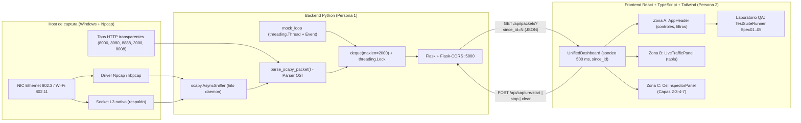
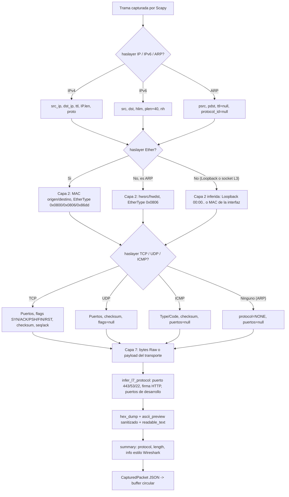
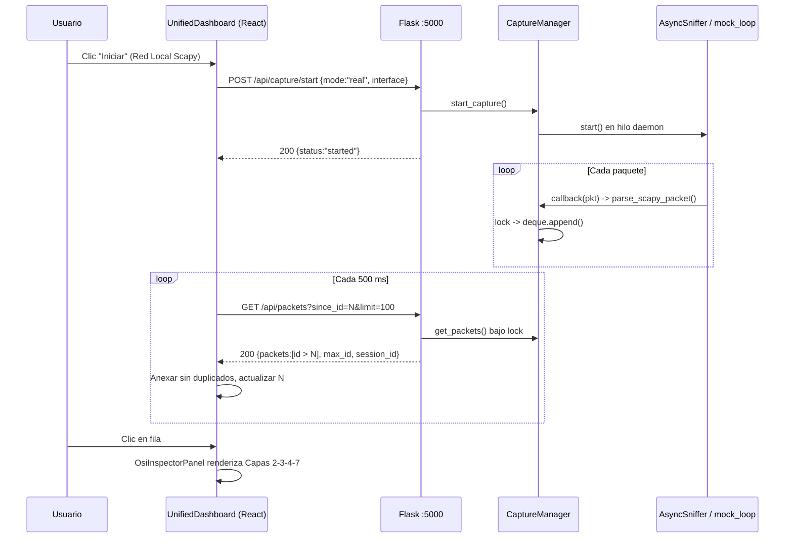
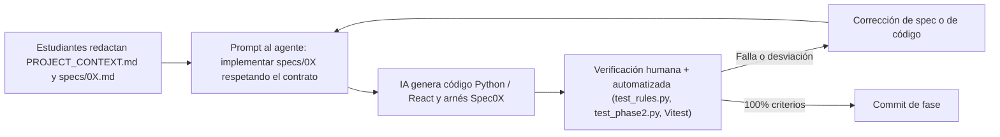
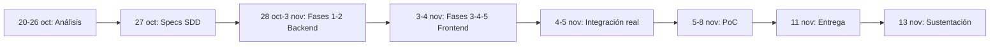

# Informe de Proyecto Final — Redes 1

## Mini-Wireshark: Analizador Pedagógico de Tráfico de Red Local con Desencapsulación Visual por Capas del Modelo OSI

| Campo | Detalle |
| :--- | :--- |
| **Asignatura** | Redes 1 |
| **Docente** | Oscar Camargo |
| **Integrantes** | `Luis Carlos Galindo Florez` (Backend: Scapy / Flask) · `Jhoan Alexander Silva Rojas` (Frontend: React / TypeScript / Tailwind) |
| **Repositorio** | `Proyecto_Mini_Wireshark` (`PROJECT_CONTEXT.md`, `/specs/01..05`, `/backend`, `/frontend`) |
| **Fecha de entrega** | 11 de noviembre de 2026 |
| **Sustentación** | 13 de noviembre de 2026 |
| **Metodología** | SDD — *Specification-Driven Development* (Desarrollo Orientado por Especificaciones) |

---

## Tabla de Contenido

1. [Análisis de la Necesidad](#sección-1-análisis-de-la-necesidad-peso-10)
2. [Marco Técnico y Metodología](#sección-2-marco-técnico-y-metodología-peso-10)
3. [Diseño de la Solución](#sección-3-diseño-de-la-solución-peso-25)
4. [Recursos Técnicos, Humanos, Financieros y Cronograma](#sección-4-recursos-técnicos-humanos-financieros-y-cronograma-peso-10)
5. [Prueba de Concepto (PoC)](#sección-5-prueba-de-concepto--poc-peso-25)
6. [Conclusiones Técnicas](#sección-6-conclusiones-técnicas-del-proyecto-peso-10)
7. [Anexo: Bitácora de Uso y Verificación de IA](#anexo-obligatorio-bitácora-de-uso-y-verificación-de-inteligencia-artificial)
8. [Referencias Bibliográficas](#referencias-bibliográficas)

---

## SECCIÓN 1: ANÁLISIS DE LA NECESIDAD (Peso: 10%)

### 1.1 Identificación y Contexto

El escenario de referencia es una **PyME tecnológica / laboratorio de desarrollo de software ubicado en Bogotá**, con una red de área local (LAN) típica de 15 a 40 estaciones de trabajo:

- Un router/gateway de borde (ej. `192.168.1.1`) que provee NAT, DHCP y reenvío DNS.
- Uno o dos switches de acceso Ethernet (IEEE 802.3) y puntos de acceso Wi-Fi (IEEE 802.11).
- Servidores internos de desarrollo levantados *ad hoc* por los desarrolladores (ej. `python -m http.server 8000`, servidores Vite en `5173`, Flask en `5000`, APIs en `3000`/`8080`) para compartir documentos, prototipos y artefactos.

En este entorno, los **administradores de red junior y los desarrolladores** necesitan, de forma recurrente:

1. **Auditar el tráfico local** para verificar si documentos internos (`.txt`, `.pdf`, `.docx`, `.html`) o credenciales viajan **en texto plano** sobre HTTP (puertos 80/8000/8080) en lugar de canales cifrados HTTPS/TLS (puerto 443).
2. **Diagnosticar fallos de resolución**: consultas DNS sin respuesta (UDP/53) o fallos de descubrimiento de vecinos ARP (`Who has 192.168.1.1?`) que impiden alcanzar el gateway.
3. **Diagnosticar conectividad** con ICMP (`ping`): presencia o ausencia de `Echo Reply`, valores de TTL anómalos.

Las herramientas industriales de referencia —**Wireshark** y **tcpdump**— resuelven técnicamente la captura, pero presentan una **alta barrera de interpretación** para perfiles junior:

- Wireshark muestra un árbol de disección colapsado por defecto, con cientos de campos por protocolo, terminología en inglés y un volcado hexadecimal sin correlación explícita con las capas del Modelo OSI.
- tcpdump entrega una línea de texto por paquete (`IP 192.168.1.15.51842 > 192.168.1.20.80: Flags [P.]...`) y requiere dominar la sintaxis BPF y opciones como `-X`/`-XX` para ver el payload; no existe ningún mapeo visual de capas.

Ninguna de las dos herramientas **traduce** el paquete a lenguaje pedagógico ("Petición de página web GET /informe.pdf", "¿Quién tiene 192.168.1.1?") ni presenta explícitamente la **ruta de encapsulación Capa 2 → 3 → 4 → 7**.

### 1.2 Descripción del Problema

> **Problema central:** Existe una dificultad operativa y cognitiva para **correlacionar en tiempo real las Unidades de Datos de Protocolo (PDU)** —Trama Ethernet (Capa 2), Paquete IP (Capa 3), Segmento TCP / Datagrama UDP (Capa 4) y Payload de Aplicación (Capa 7)— con su capa correspondiente del Modelo OSI durante el diagnóstico de una red local.

Esta dificultad se manifiesta en tres síntomas medibles:

| Síntoma | Manifestación técnica | Consecuencia |
| :--- | :--- | :--- |
| **S1. Exceso de pasos de inspección** | En Wireshark, ver las 4 PDU de un paquete exige seleccionar la fila y expandir manualmente 4 subárboles (Ethernet II, IPv4, TCP/UDP, datos) — 5 acciones mínimas. | Mayor tiempo de diagnóstico por paquete. |
| **S2. Ambigüedad de casos especiales** | ARP no tiene cabecera de Capa 4 ni TTL; ICMP viaja dentro de IP (protocolo 1) pero no usa puertos. Las herramientas no lo explican. | Errores conceptuales del personal junior (buscar "el puerto del ping"). |
| **S3. Detección tardía de texto plano** | Identificar que un documento viaja sin cifrar exige "Follow TCP Stream" o leer volcados hexadecimales. | Exposición de información sensible no detectada. |

### 1.3 Justificación e Impacto

| Dimensión | Impacto esperado | Indicador asociado (verificado en la PoC, Sección 5) |
| :--- | :--- | :--- |
| **Reducción del tiempo de diagnóstico** | Las 4 capas del paquete seleccionado se muestran simultáneamente en el Inspector OSI con un solo clic. | Pasos para inspeccionar una PDU de 4 capas: **5 → 1** (2 si se abre el volcado Hex/ASCII). |
| **Detección inmediata de tráfico no cifrado** | El parser clasifica `HTTP` vs `HTTPS/TLS` por puerto y por firma de contenido (`GET `, `POST `, `HTTP/1.`, `Host:`) y muestra el payload ASCII legible. | Precisión de clasificación de protocolos: **7/7 (100%)** en el banco de referencia. |
| **Trazabilidad extremo a extremo** | Cada paquete conserva MAC, IP, TTL, puertos, flags, checksum y payload en un contrato JSON único (`CapturedPacket`). | **10/10 reglas** del contrato OSI cumplidas sobre **1000/1000** paquetes generados. |
| **Valor formativo** | Notas pedagógicas en español por capa y manejo explícito de ARP/ICMP sin Capa 4. | 5/5 suites SDD de frontend aprobadas (29/29 pruebas Vitest). |

### 1.4 Delimitación y Alcance

#### Objetivo General

Diseñar, implementar y validar un analizador de tráfico de red local en tiempo real —**Mini-Wireshark**— que intercepte tramas reales de la interfaz de red mediante Scapy, las desencapsule y normalice en un contrato JSON estructurado por capas del Modelo OSI (2, 3, 4 y 7), y las presente en una interfaz web pedagógica que permita a administradores junior y desarrolladores diagnosticar tráfico ARP, DNS, ICMP, TCP, UDP y HTTP/HTTPS con una API de latencia inferior a 200 ms.

#### Objetivos Específicos

| # | Objetivo específico | Fase SDD | Criterio de verificación |
| :--- | :--- | :--- | :--- |
| OE1 | Implementar un motor de captura con Scapy (`AsyncSniffer`) que transforme cada trama al contrato `CapturedPacket` (Capas 2, 3, 4 y 7), con modo *mock* sin privilegios. | Fase 1 | 10 reglas de `Spec01CaptureTest.tsx` / `test_rules.py`. |
| OE2 | Exponer el motor mediante una API REST Flask concurrente, *thread-safe*, con buffer circular y consulta incremental `since_id`. | Fase 2 | 4 criterios de `Spec02ApiStreamTest.tsx` / `test_phase2.py`; latencia < 200 ms. |
| OE3 | Construir una tabla de tráfico en tiempo real con filtrado por protocolo e IP y selección de paquetes. | Fase 3 | 5 criterios de `Spec03TrafficTableTest.tsx`. |
| OE4 | Construir un Inspector Visual OSI con tarjetas por capa, guías pedagógicas, manejo de ARP/ICMP y visor Hex/ASCII. | Fase 4 | 5 criterios de `Spec04OsiInspectorTest.tsx`. |
| OE5 | Unificar la aplicación en un layout de 3 zonas en tema claro, aislando las pruebas en un "Laboratorio QA". | Fase 5 | 6 criterios de `Spec05UnifiedUiTest.tsx`. |

#### Relación Explícita con los Temas del Curso Redes 1

| Tema del curso | Dónde se materializa en el proyecto |
| :--- | :--- |
| **Modelo OSI** | Contrato `osi_layers` con `layer2_datalink`, `layer3_network`, `layer4_transport`, `layer7_application`; Inspector con ruta `Capa 2 → 3 → 4 → 7`. |
| **Modelo TCP/IP** | Consolidación de Capas 5–6 dentro de `layer7_application` (modelo híbrido TCP/IP–OSI, `PROJECT_CONTEXT.md` §1). |
| **Conmutación de paquetes** | Cada trama capturada es una unidad independiente con su propio encabezado; secuencia observable mediante `seq_num`/`ack_num` y `id` incremental. |
| **Direccionamiento MAC** | Extracción y normalización `XX:XX:XX:XX:XX:XX` (`format_mac`), detección de Broadcast `FF:FF:FF:FF:FF:FF`. |
| **Direccionamiento IPv4** | `src_ip`, `dst_ip`, `ttl`, `length`, `protocol_id` (IANA: 1, 6, 17). Soporte IPv6 (`hlim`). |
| **TCP** | Puertos, flags (`SYN`, `ACK`, `PSH`, `FIN`, `RST`, `URG`), números de secuencia/acuse, checksum. |
| **UDP** | Puertos y checksum; `flags = null` por diseño (UDP no tiene control de conexión). |
| **ARP** | `psrc`/`pdst`, `ttl = null`, Capa 4 `NONE`, resumen `Who has X? Tell Y`. |
| **DNS** | Clasificación por puerto 53 sobre UDP; nombre consultado visible en el ASCII del payload. |
| **ICMP** | Tipo/código (`Echo Request (Type 8, Code 0)`, `Echo Reply (Type 0, Code 0)`), puertos `null`. |

#### Fuera de Alcance

- Reensamblado completo de flujos TCP (*stream reassembly*) y descifrado TLS.
- Capturas en modo monitor 802.11 (tramas de gestión Wi-Fi); se trabaja con la trama Ethernet II que entrega el driver.
- Exportación a formato `.pcap`/`.pcapng`.
- Persistencia en base de datos (el buffer es en memoria, 2000 paquetes).

---

## SECCIÓN 2: MARCO TÉCNICO Y METODOLOGÍA (Peso: 10%)

### 2.1 Fundamento Conceptual

#### 2.1.1 Encapsulación y Desencapsulación en el Modelo OSI

El Modelo de Referencia OSI (ISO/IEC 7498-1) organiza la comunicación en siete capas, donde cada capa del emisor añade su propia cabecera (y eventualmente un tráiler) a la unidad de datos recibida de la capa superior — proceso denominado **encapsulación** (Tanenbaum, Feamster & Wetherall, 2021, cap. 1). En el receptor ocurre el proceso inverso, la **desencapsulación**: cada capa lee y retira su cabecera antes de entregar la carga útil a la capa superior. Kurose y Ross (2021, §1.5.2) describen la PDU resultante en cada nivel como *mensaje* (aplicación), *segmento* (transporte), *datagrama* (red) y *trama* (enlace).

Mini-Wireshark reproduce **por software** la desencapsulación del receptor. Scapy entrega cada trama capturada como una pila de objetos anidados (`Ether / IP / TCP / Raw`), y la función `parse_scapy_packet()` de `backend/packet_engine.py` recorre esa pila consultando `pkt.haslayer(...)`:

| Capa OSI | PDU | Clase Scapy consultada | Bloque JSON generado |
| :--- | :--- | :--- | :--- |
| 2 — Enlace de Datos | Trama (*Frame*) | `Ether` (o `ARP.hwsrc/hwdst` como respaldo) | `layer2_datalink` |
| 3 — Red | Paquete / Datagrama IP | `IP`, `IPv6`, `ARP` | `layer3_network` |
| 4 — Transporte | Segmento TCP / Datagrama UDP / mensaje ICMP | `TCP`, `UDP`, `ICMP` | `layer4_transport` |
| 7 — Aplicación (5–6 consolidadas) | Datos (*Payload*) | `Raw` o `payload` del transporte | `layer7_application` |

> [!NOTE]
> **Decisión de diseño sobre ICMP.** ICMP es un protocolo compañero de la Capa 3 (RFC 792) que viaja encapsulado dentro de IP con `protocol = 1`. El contrato lo ubica en la ranura `layer4_transport` porque ocupa la carga útil de IP, pero fija `src_port = null` y `dst_port = null`; el Inspector OSI aclara al usuario que ICMP no usa puertos ni sockets de transporte.

Una particularidad del orden de procesamiento en el código es que **la Capa 3 se evalúa antes que la Capa 2**: cuando la captura se realiza por socket nativo de Capa 3 (sin Npcap) o por interfaz *loopback*, no existe objeto `Ether`, y el motor necesita conocer las IPs para inferir la representación de Capa 2 (`"Loopback"` con MAC `00:00:00:00:00:00`, o la MAC de la interfaz local).

#### 2.1.2 Campos Reales Extraídos por el Proyecto

**Capa 2 — Ethernet II (IEEE 802.3-2022; RFC 894).** La trama Ethernet II contiene MAC destino (6 bytes), MAC origen (6 bytes) y el campo **EtherType** (2 bytes), que identifica el protocolo encapsulado: `0x0800` = IPv4, `0x0806` = ARP, `0x86DD` = IPv6. Una MAC es un identificador de 48 bits asociado a la NIC y su alcance es el **salto local** (Kurose & Ross, 2021, §6.4.1).

| Campo JSON | Origen en Scapy | Normalización en el código |
| :--- | :--- | :--- |
| `src_mac`, `dst_mac` | `Ether.src`, `Ether.dst` | `format_mac()` → `XX:XX:XX:XX:XX:XX` en mayúsculas |
| `ethertype` | `Ether.type` | `format_ethertype()` → `0x%04x` |
| `ethertype_name` | Tabla interna | `IPv4` / `ARP` / `IPv6` / `Unknown (0x....)` |
| `protocol` | — | `"Ethernet II"` o `"Loopback"` |

**Capa 3 — IPv4 (RFC 791), IPv6 (RFC 8200) y ARP (RFC 826).** La cabecera IPv4 incluye, entre otros, *Total Length* (16 bits), *Time To Live* (8 bits, decrementado en cada router para evitar bucles) y *Protocol* (8 bits; 1 = ICMP, 6 = TCP, 17 = UDP). ARP resuelve direcciones IPv4 a MAC en la LAN mediante una solicitud *broadcast* y no posee TTL, por lo que el contrato fija `ttl = null` y `protocol_id = null`.

| Campo JSON | IPv4 | IPv6 | ARP |
| :--- | :--- | :--- | :--- |
| `src_ip` / `dst_ip` | `IP.src` / `IP.dst` | `IPv6.src` / `IPv6.dst` | `ARP.psrc` / `ARP.pdst` |
| `ttl` | `IP.ttl` (acotado 1–255) | `IPv6.hlim` | `null` |
| `length` | `max(len(pkt), IP.len)` | `IPv6.plen + 40` | `len(pkt)` |
| `protocol_id` | `IP.proto` | `IPv6.nh` | `null` |

**Capa 4 — TCP (RFC 793, actualizado por RFC 9293), UDP (RFC 768) e ICMP (RFC 792).** TCP es orientado a conexión: usa números de secuencia y acuse, y las banderas de control `SYN`, `ACK`, `PSH`, `FIN`, `RST`, `URG` para el *three-way handshake*, la entrega y el cierre. UDP solo aporta puertos, longitud y checksum. ICMP aporta *Type* y *Code*.

| Campo JSON | TCP | UDP | ICMP | ARP |
| :--- | :--- | :--- | :--- | :--- |
| `protocol` | `"TCP"` | `"UDP"` | `"ICMP"` | `"NONE"` |
| `src_port` / `dst_port` | `sport` / `dport` | `sport` / `dport` | `null` | `null` |
| `flags` | `parse_tcp_flags()` → ej. `"SYN"`, `"ACK, PSH"` | `null` | `parse_icmp_flags()` → `"Echo Request (Type 8, Code 0)"` | `null` |
| `checksum` | `0x%04x` | `0x%04x` | `0x%04x` | `null` |
| `seq_num` / `ack_num` | `seq` / `ack` | `null` | `null` | — |

**Capa 7 — Payload Hexadecimal/ASCII.** Se extraen los bytes de `Raw.load` o, si Scapy ya disecó una capa superior (por ejemplo `DNS`), los bytes de la carga útil del transporte (`_extract_transport_payload_bytes`). El protocolo de aplicación se infiere en `infer_l7_protocol()`:

1. Puerto 443/8443 → `HTTPS/TLS`; 53 → `DNS`; 22 → `SSH`.
2. Firma de contenido HTTP en los primeros 64 bytes (`GET `, `POST `, `PUT `, `DELETE `, `HEAD `, `OPTIONS `, `PATCH `, `HTTP/1.`, `HTTP/2`) o cabeceras en los primeros 512 bytes (`Host:`, `Content-Type:`, `User-Agent:`…) → `HTTP`.
3. Puertos HTTP de desarrollo (`80, 8000, 8080, 8008, 8081, 8888, 3000, 5000, 9000`) → `HTTP`.
4. `ICMP Data`, `ARP Payload`, `RAW` o `No Payload`.

| Campo JSON | Implementación |
| :--- | :--- |
| `payload_size` | `len(payload_bytes)` |
| `hex_dump` | `format_hex_dump()`: pares hexadecimales separados por espacio, hasta 16 384 bytes |
| `ascii_preview` | `sanitize_ascii()`: conserva bytes 32–126, convierte `\n`, `\r`, `\t` a espacio, y reemplaza cualquier otro byte por `.` (Regla 10) |
| `readable_text` *(extensión)* | `extract_readable_text()`: texto UTF-8 limpio y extracción de texto de `.docx` (ZIP + `word/document.xml`) y `.pdf` (streams `zlib`) para auditar documentos transmitidos |

### 2.2 Tabla de Parámetros y Requerimientos Técnicos de la Solución

| Parámetro | Valor / Requerimiento | Fuente en el repositorio |
| :--- | :--- | :--- |
| **Interfaz de red objetivo** | Ethernet IEEE 802.3 y Wi-Fi IEEE 802.11 (trama entregada al SO como Ethernet II); *loopback* | `list_network_interfaces()`, `resolve_interface_metadata()` |
| **Descubrimiento de interfaces** | `GET /api/interfaces`, filtrando adaptadores virtuales (WAN Miniport, Teredo, 6to4, filtros NDIS) y priorizando la interfaz por defecto con IP LAN no APIPA | `packet_engine.py` |
| **Tamaño máximo de trama** | MTU Ethernet 1500 bytes de carga útil (trama de 1514 bytes sin FCS); el motor no impone MTU y acepta cualquier longitud entregada por el driver | IEEE 802.3, RFC 894 |
| **Protocolos soportados** | L2: Ethernet II, Loopback · L3: IPv4, IPv6, ARP · L4: TCP, UDP, ICMP · L7: HTTP, HTTPS/TLS, DNS, SSH, RAW | `parse_scapy_packet()` |
| **Clasificación de resumen** | `TCP`, `UDP`, `ICMP`, `ARP`, `HTTP`, `HTTPS`, `DNS`, `OTHER` | `PacketProtocol` (`PROJECT_CONTEXT.md` §5.1) |
| **Latencia máxima de API** | Objetivo de diseño del equipo: **< 200 ms**; umbral automatizado del arnés `Spec02ApiStreamTest.tsx` y `test_phase2.py`: < 250 ms | Spec 02 §5 |
| **Capacidad del buffer** | Buffer circular `collections.deque(maxlen=2000)` protegido por `threading.Lock()` | `CaptureManager(max_packets=2000)` |
| **Paginación de la API** | `limit` por defecto 200, máximo 1000; consulta incremental `since_id` | `GET /api/packets` |
| **Frecuencia de sondeo del frontend** | 500 ms (`setInterval`), `limit=100` | `UnifiedDashboard.tsx` |
| **Tasa del generador mock** | 1 paquete cada 0,4 s (≈ 2,5 pps), rotando HTTP, HTTPS, DNS, ICMP, ARP | `_start_mock_thread()` |
| **Modos de captura** | `real` (Npcap/libpcap L2 → socket L3 nativo → Taps HTTP locales) y `mock` | `_start_real_scapy_sniffers()` |
| **Entorno de ejecución backend** | Python 3.13 (requisito ≥ 3.10), `scapy>=2.5.0`, `flask>=3.0.0`, `flask-cors>=4.0.0`, Npcap (Windows) | `requirements.txt` |
| **Entorno de ejecución frontend** | React 19, TypeScript, Tailwind CSS 4, Vite 8, Vitest 5 + Testing Library + jsdom | `frontend/package.json` |
| **Puertos de servicio** | Flask `127.0.0.1:5000`, Vite `localhost:5173` | `start_dev.bat` |
| **Privilegios** | Captura real: consola de Administrador (UAC solicitado por `start_dev.bat`); modo mock: sin privilegios | `start_dev.bat` |

### 2.3 Metodología de Desarrollo e Ingeniería

#### 2.3.1 SDD — Specification-Driven Development

El proyecto se gobierna por `PROJECT_CONTEXT.md` (fuente única de verdad) y cinco especificaciones formales en `/specs/`. Las reglas aplicadas fueron:

1. **Primacía de la especificación:** ningún nombre de campo JSON, endpoint o *prop* de componente puede cambiar sin actualizar primero la especificación (prohibición de deriva de contrato).
2. **Vinculación 1:1 especificación ↔ arnés de pruebas:** cada `specs/0X-*.md` tiene su arnés ejecutable `frontend/src/tests/Spec0X*.tsx` y su suite automatizada Vitest `Spec0X*.test.tsx`.
3. **Criterio de completitud:** una fase solo se considera completada cuando el 100% de sus criterios de aceptación pasan.
4. **Auditoría final integrada** mediante `TestSuiteRunner.tsx`, accesible desde el botón "Laboratorio QA".

#### 2.3.2 Fases, Responsables y Criterios de Evaluación

| Fase | Responsable | Especificación | Artefacto principal | Criterio técnico de evaluación |
| :--- | :--- | :--- | :--- | :--- |
| **1. Motor de captura y mapeo OSI** | Persona 1 | `01-motor-captura-osi.md` | `backend/packet_engine.py` | 10 reglas del contrato: metadatos raíz, 4 capas, formato MAC, EtherType `0x`, IP válida, TTL 1–255 o `null` en ARP, coherencia de puertos, checksum hexadecimal, consistencia de payload, ASCII imprimible. |
| **2. API Flask concurrente** | Persona 1 | `02-api-flask-streaming.md` | `backend/app.py` | CORS, ciclo `start/stop/clear`, idempotencia (`already_running`), latencia sin bloqueo, flujo incremental `since_id`. |
| **3. Tabla de tráfico en tiempo real** | Persona 2 | `03-tabla-trafico-tiempo-real.md` | `TrafficPacketTable.tsx`, `TrafficFilterBar.tsx`, `CaptureControlBar.tsx` | 7 columnas, filtro por protocolo, filtro por IP, evento `onSelectPacket`, inyección de ráfagas sin congelar la UI. |
| **4. Inspector Visual OSI** | Persona 2 | `04-inspector-visual-osi.md` | `OsiInspector.tsx`, `OsiStackVisualizer.tsx`, `OsiLayerAccordionCard.tsx`, `HexAsciiPayloadViewer.tsx`, `osiPedagogicalGuides.ts` | Estado vacío sin `TypeError`, 4 capas completas, ARP/ICMP sin `undefined`/`NaN`, acordeones, visor Hex/ASCII. |
| **5. Rediseño unificado en tema claro** | Persona 2 | `05-rediseño-frontend-claro-unificado.md` | `UnifiedDashboard.tsx`, `AppHeader.tsx`, `LiveTrafficPanel.tsx`, `OsiInspectorPanel.tsx` | Cero clases oscuras, cero ruido de testing, layout de 3 zonas, flujo extremo a extremo con selección < 100 ms, pedagogía presente, Laboratorio QA aislado. |

#### 2.3.3 Cómo se Capturaron los Datos

Se emplearon tres fuentes de datos complementarias:

1. **Tráfico real de la interfaz** (modo `real`): `scapy.AsyncSniffer(iface, prn=callback, store=False, filter=bpf)` sobre Npcap; con respaldo a `conf.L3socket(promisc=True)` si Npcap no está disponible.
2. **Taps HTTP transparentes** (modo `real`, Windows): sockets enlazados a la IP de la interfaz en los puertos `8000, 8080, 8888, 3000, 8008` que reenvían byte a byte hacia `127.0.0.1:<puerto>` y registran la petición y la respuesta HTTP reales (ver §3.2.4).
3. **Tráfico sintético determinista** (modo `mock`): `MockPacketGenerator` con plantillas `http_get`, `https_handshake`, `dns_query`, `icmp_ping`, `arp_request`, usado para pruebas reproducibles sin privilegios.

Adicionalmente, para la PoC se construyó un **banco de paquetes de referencia** con Scapy (Ethernet/IP/TCP/UDP/ICMP/ARP/DNS serializados a bytes y re-disecados, como llegarían del cable) para medir la precisión de clasificación y el cumplimiento del contrato de forma reproducible (Sección 5.2).

---

## SECCIÓN 3: DISEÑO DE LA SOLUCIÓN (Peso: 25%)

### 3.1 Arquitectura del Sistema

#### 3.1.1 Diagrama de Arquitectura (Backend Scapy → API Flask Concurrente → Frontend React)



#### 3.1.2 Diagrama de Flujo de Desencapsulación OSI de un Paquete Capturado



#### 3.1.3 Secuencia de Interacción Cliente–Servidor



### 3.2 Diseño del Motor de Captura y Mapeo OSI (Fases 1 y 2)

#### 3.2.1 Intercepción de Tramas en la Tarjeta de Red

`CaptureManager._start_real_scapy_sniffers()` implementa una **estrategia de captura en cascada** con tres niveles, de mayor a menor fidelidad:

| Intento | Mecanismo | Condición | Capa más baja visible |
| :--- | :--- | :--- | :--- |
| 1 | `scapy.AsyncSniffer(iface, prn, store=False, filter=bpf)` | `scapy.conf.use_pcap == True` (Npcap/libpcap instalado) | Capa 2 completa (trama Ethernet real) |
| 2 | `conf.L3socket(iface, promisc=True)` + `AsyncSniffer(opened_socket=sock)` | Sin Npcap; socket nativo del SO | Capa 3 (MAC inferida de la interfaz) |
| 3 | Taps HTTP transparentes | Al menos un puerto de desarrollo enlazado | Capa 7 HTTP con encabezados L2–L4 reconstruidos |

Tras arrancar cada sniffer, el código espera 150 ms y verifica `sniffer.running` y `sniffer.exception` antes de darlo por válido; si todos los intentos fallan, devuelve un mensaje accionable ("Ejecuta `start_dev.bat` como Administrador o instala Npcap").

Dos filtros evitan contaminar la captura:

- `_is_internal_dashboard_polling()`: descarta segmentos TCP con puerto 5000 o 5173 (el sondeo del propio dashboard), salvo que el usuario incluya esos puertos en el filtro BPF.
- Si los Taps están activos, se descartan los paquetes del sniffer en los puertos de desarrollo para no duplicar el mismo intercambio HTTP.

#### 3.2.2 Transformación al Contrato JSON Estandarizado

Cada paquete se convierte en un objeto `CapturedPacket` (`PROJECT_CONTEXT.md` §5). Ejemplo real producido por `parse_scapy_packet()` durante la PoC para una petición HTTP con un documento en texto plano:

```json
{
  "summary": {
    "src_ip": "192.168.1.15", "dst_ip": "192.168.1.20",
    "protocol": "HTTP", "length": 181,
    "info": "51842 → 80 [ACK, PSH] POST /upload HTTP/1.1 Seq=0 Len=127"
  },
  "osi_layers": {
    "layer2_datalink": { "protocol": "Ethernet II", "src_mac": "3C:52:82:1A:2B:3C",
                         "dst_mac": "F4:6D:04:AA:BB:CC", "ethertype": "0x0800", "ethertype_name": "IPv4" },
    "layer3_network":  { "protocol": "IPv4", "src_ip": "192.168.1.15", "dst_ip": "192.168.1.20",
                         "ttl": 128, "length": 181, "protocol_id": 6 },
    "layer4_transport":{ "protocol": "TCP", "src_port": 51842, "dst_port": 80,
                         "flags": "ACK, PSH", "checksum": "0xe3ad", "seq_num": 0, "ack_num": 0 },
    "layer7_application": { "protocol_hint": "HTTP", "payload_size": 127,
                         "hex_dump": "50 4f 53 54 20 2f 75 70 6c 6f 61 64 20 48 54 54 50 2f 31 2e ...",
                         "ascii_preview": "POST /upload HTTP/1.1  Host: 192.168.1.20:8000  Content-Type: text/plain    Informe confidencial: usuario=admin clave=Redes2026" }
  }
}
```

El campo `summary.protocol` se deriva jerárquicamente: primero la Capa 7 (`HTTP`, `HTTPS`, `DNS`), luego la Capa 4 (`TCP`, `UDP`, `ICMP`), luego `ARP` y por último `OTHER`. El campo `summary.info` replica el estilo de Wireshark (`puerto → puerto [flags] primera-línea-del-payload Seq= Len=`).

#### 3.2.3 Concurrencia en Flask sin Bloquear la Captura

El sniffing es una operación de E/S continua que nunca se ejecuta en el hilo que atiende HTTP. El diseño de `CaptureManager` (`backend/app.py`) aplica el patrón **productor–consumidor**:

| Elemento | Implementación | Propósito |
| :--- | :--- | :--- |
| Productor real | `AsyncSniffer` (hilo daemon interno de Scapy) | Captura sin bloquear Flask |
| Productor mock | `threading.Thread(target=mock_loop, daemon=True)` con `stop_event.wait(0.4)` | Emisión periódica interrumpible |
| Señal de parada | `threading.Event()` (`stop_event`) | `graceful stop` en < 1 s (`join(timeout=1.0)`) |
| Exclusión mutua | `threading.Lock()` | Protege `seq_counter`, `deque` y estado |
| Sección crítica mínima | El parseo (`parse_scapy_packet`) se hace **fuera** del lock; solo la asignación de `id` y el `append` lo toman | Minimizar contención entre productor y consultas HTTP |
| Buffer circular | `collections.deque(maxlen=2000)` | Evita `MemoryError` en capturas prolongadas |
| Consumidores | Rutas Flask: `/api/status`, `/api/packets`, `/api/capture/*`, `/api/interfaces` | Leen una instantánea bajo lock |
| Idempotencia | `start_capture()` devuelve `already_running` si el modo e interfaz coinciden | No duplica hilos de captura |
| Detección de reinicio | `session_id` y `max_id` en cada respuesta | El frontend reinicia `since_id` si el backend se reinició o se limpió |

Endpoints implementados:

| Método | Ruta | Función |
| :--- | :--- | :--- |
| `GET` | `/api/interfaces` | Catálogo de interfaces reales detectadas por Scapy y disponibilidad de pcap |
| `GET` | `/api/status` | Estado, modo, interfaz, IP local, conteo, *uptime*, último error |
| `POST` | `/api/capture/start` | Inicia captura `real`/`mock` con interfaz y filtro BPF opcionales |
| `POST` | `/api/capture/stop` | Detención ordenada conservando el buffer |
| `POST` | `/api/capture/clear` | Vacía el buffer, reinicia el contador y genera nuevo `session_id` |
| `GET` | `/api/packets` | Consulta incremental `since_id`, `limit` (≤ 1000) y filtro `protocol` |

#### 3.2.4 Taps HTTP Transparentes (Solución a una Restricción de Windows)

Durante las pruebas se identificó que en Windows sin el adaptador *Npcap Loopback*, las conexiones del navegador hacia un servidor de la misma máquina (`python -m http.server 8000`) se resuelven por la ruta rápida de *loopback* de `tcpip.sys` y **no atraviesan el driver NDIS**, por lo que Scapy no las observa. `_start_transparent_local_taps()` enlaza sockets a la IP real de la interfaz (y a `[::1]`) en los puertos de desarrollo, reenvía cada petición a `127.0.0.1:<puerto>` y registra **dos paquetes reales por intercambio**: la petición HTTP del cliente y la respuesta con el contenido íntegro del documento (hasta 512 KB), añadiendo la cabecera informativa `X-Requested-File`. También elimina `If-Modified-Since`/`If-None-Match`/`Range` y agrega un *cache-buster* en el listado del directorio para forzar que el navegador vuelva a solicitar el archivo por la red.

> [!IMPORTANT]
> **Limitación declarada.** En la ruta de Taps, el payload de Capa 7, las IPs y los puertos son los reales del intercambio, pero la **trama Ethernet y el TTL se reconstruyen** (MAC de la interfaz local en ambos extremos, `ttl=64`) y el mensaje HTTP se registra **reensamblado** como un solo paquete, no segmentado por MSS. Para evidenciar MACs y TTL reales del cable en la sustentación, el Escenario A debe ejecutarse con Npcap instalado y el cliente en otro equipo de la LAN (§5.1).

### 3.3 Diseño de la Interfaz Visual y Pedagógica (Fases 3, 4 y 5)

#### 3.3.1 Layout de 3 Zonas en Pantalla Única (Fase 5)

```text
+--------------------------------------------------------------------------------------+
| ZONA A · AppHeader: marca, estado en vivo, selector "Red Local (Scapy)" / "Tráfico     |
| Simulado", interfaz, Iniciar/Pausar/Limpiar, chips de protocolo, buscador, Lab. QA    |
+-----------------------------------------------------+--------------------------------+
| ZONA B · LiveTrafficPanel (~58%)                    | ZONA C · OsiInspectorPanel     |
| "Mostrando X de Y paquetes" · auto-desplazamiento   | (~42%)                         |
| # | Hora | Origen:puerto | Destino:puerto |         | Resumen del paquete            |
| Protocolo | Actividad en la Red (español)           | Ruta Capa 2 → 3 → 4 → 7        |
|                                                     | Tarjetas Capas 2, 3, 4 y 7     |
|                                                     | "Ver datos crudos (Hex/ASCII)" |
+-----------------------------------------------------+--------------------------------+
```

#### 3.3.2 Tabla de Tráfico en Tiempo Real

- **Fase 3** (`TrafficPacketTable.tsx`): 7 columnas obligatorias (`No.`, `Tiempo`, `IP Origen`, `IP Destino`, `Protocolo`, `Longitud`, `Info`), selección por `onSelectPacket(packet)` entregando el objeto íntegro con sus 4 capas.
- **Fase 5** (`LiveTrafficPanel.tsx`): columnas orientadas a la pedagogía. `Origen`/`Destino` muestran `IP:puerto` (`formatEndpointAddress`), y la columna **"Actividad en la Red"** (`translatePacketActivity`) traduce el paquete a español: *"Petición de página web (GET /informe.pdf)"*, *"Respuesta web (HTTP/1.0 200 OK · informe.pdf · application/pdf · N bytes)"*, *"Comprobación de conectividad (Echo Request / Ping)"*, *"¿Quién tiene 192.168.1.1? Responder a 192.168.1.15"*.
- **Fila seleccionada:** `bg-blue-50/70 border-l-4 border-blue-600`.
- **Sincronización:** `UnifiedDashboard` sondea `GET /api/packets?since_id=N&limit=100` cada 500 ms, deduplica por `id` con un `Set` y conserva la selección del usuario.

#### 3.3.3 Sistema de Filtrado por Protocolo / IP

`filterUnifiedPackets(packets, selectedProtocol, searchQuery)` aplica dos etapas en el cliente:

1. **Chip de protocolo:** `Todos`, `Web (HTTP)` (incluye `HTTPS`), `TCP`, `UDP`, `DNS`, `Ping (ICMP)`, `Red Local (ARP)`; comparación exacta contra `summary.protocol`.
2. **Buscador universal:** coincidencia por puerto exacto (`8000` o `:8000`), `IP:puerto` de origen/destino, protocolo, `info`, actividad traducida, `ascii_preview`, `readable_text`, `hex_dump` y direcciones MAC. Esto permite buscar directamente una cadena sensible (por ejemplo `clave=`) dentro del payload capturado.

Además, el backend admite el filtro `protocol` en `/api/packets` y el filtro BPF del kernel en `start` (por ejemplo `"tcp port 8000 or udp port 53 or icmp or arp"`).

#### 3.3.4 Inspector Visual de Encapsulación OSI en Tema Claro

| Elemento | Componente | Comportamiento |
| :--- | :--- | :--- |
| Estado vacío | `OsiInspectorPanel` | *"Selecciona un paquete de la tabla para desglosar sus cabeceras en el Modelo OSI"* (sin `TypeError` con `packet = null`) |
| Ruta de encapsulación | `OsiPathwayBar` / `OsiStackVisualizer` | `[Capa 2] → [Capa 3] → [Capa 4] → [Capa 7]`; en ARP la Capa 4 aparece en gris con *"Omitida por diseño del protocolo"* |
| Tarjeta Capa 2 | — | MAC origen → MAC destino, EtherType con traducción (`0x0800 - IPv4`), nota pedagógica |
| Tarjeta Capa 3 | — | IP origen → destino, TTL, longitud total, explicación del TTL anti-bucles |
| Tarjeta Capa 4 | — | Protocolo, puerto cliente → servicio, flags, checksum; en ARP/ICMP: *"no utiliza puertos ni sockets de transporte"* |
| Tarjeta Capa 7 | `HexAsciiPayloadViewer` | Servicio inferido, tamaño de payload; acordeón *"Ver datos crudos (Hexadecimal / ASCII)"* colapsado por defecto; aviso para paquetes de control sin payload |
| Guías pedagógicas | `osiPedagogicalGuides.ts` | Explicaciones en español por campo (Broadcast, EtherType, TTL, multiplexación por puertos, *three-way handshake*, checksum) |

Sistema cromático (Spec 05 §2.3): HTTP/HTTPS esmeralda, TCP azul, UDP índigo, DNS ámbar, ICMP rosa, ARP cian, otros gris pizarra, sobre superficies `bg-white` / `bg-slate-50` y texto `text-slate-900`.

### 3.4 Justificación frente a Alternativas

| Criterio técnico | Wireshark (GUI) | tcpdump (CLI) | **Mini-Wireshark Web OSI** |
| :--- | :--- | :--- | :--- |
| Motor de captura | libpcap/Npcap + 3000+ disectores | libpcap | Scapy sobre Npcap/libpcap, socket L3 o Taps HTTP |
| Cobertura de protocolos | Muy alta | Alta | Acotada: Ethernet II, IPv4/IPv6, ARP, TCP, UDP, ICMP, HTTP, TLS, DNS, SSH |
| Mapeo explícito al Modelo OSI | No (árbol por protocolo) | No | **Sí**: contrato JSON y tarjetas por Capa 2/3/4/7 |
| Pasos para ver las 4 PDU de un paquete | 5 (seleccionar + expandir 4 subárboles) | Requiere relanzar con `-e -v -X` y leer texto | **1** (2 con volcado Hex/ASCII) |
| Explicación de ARP/ICMP sin Capa 4 | No | No | **Sí**, nota explícita |
| Traducción a lenguaje natural | No | No | **Sí** ("Actividad en la Red" en español) |
| Detección de texto plano | "Follow TCP Stream" manual | `-A`/`-X` manual | Clasificación HTTP vs HTTPS + ASCII + búsqueda en payload + extracción `.docx`/`.pdf` |
| Reensamblado TCP / descifrado TLS / exportar pcap | Sí | Parcial (pcap) | No (fuera de alcance) |
| Interfaz | Escritorio | Consola | Navegador web (React), API REST reutilizable |
| Curva de aprendizaje para perfil junior | Alta | Muy alta | Baja (orientada a pedagogía) |
| Licencia | GPLv2 | BSD | Componentes libres (Scapy GPLv2, Flask BSD, React MIT); Npcap con licencia propia |

**Conclusión de la comparación:** Mini-Wireshark no compite en cobertura con Wireshark; se justifica como **herramienta de diagnóstico de primer nivel y formación** que reduce la carga cognitiva, y deja a Wireshark para el análisis forense profundo.

### 3.5 Rol Concreto de la Inteligencia Artificial en el Diseño

La IA se usó como **agente de implementación guiado por especificaciones**, nunca como fuente de requisitos. El flujo fue:



| Uso de IA | Entrada (especificación) | Resultado | Control humano |
| :--- | :--- | :--- | :--- |
| **Estructurar contratos JSON** | `PROJECT_CONTEXT.md` §5 | Interfaces TypeScript `CapturedPacket`, `OsiLayer2DataLink`… y validadores de esquema en `Spec01CaptureTest.tsx` | Revisión de cada campo contra RFC 791/793/768/826 e IEEE 802.3 |
| **Generar el parser OSI** | `specs/01-motor-captura-osi.md` | `parse_scapy_packet()`, `format_mac()`, `sanitize_ascii()`, `infer_l7_protocol()`, `MockPacketGenerator` | 10 reglas ejecutadas con `test_rules.py`; pruebas con tráfico real |
| **Generar la API concurrente** | `specs/02-api-flask-streaming.md` | `CaptureManager`, rutas Flask, buffer circular | `test_phase2.py` (latencia y `since_id`) |
| **Diagnosticar restricciones del SO** | Fallo observado: el navegador local no aparecía en la captura | Taps HTTP transparentes | Prueba manual con `python -m http.server 8000` y documentos reales |
| **Refactorizar la interfaz visual** | `specs/05-rediseño-frontend-claro-unificado.md` | Migración de tema oscuro a Clean Light UI y layout de 3 zonas | `Spec05UnifiedUi.test.tsx` (cero clases `bg-slate-900`/`bg-gray-800`, cero textos "Fase"/"PASS") |

La trazabilidad detallada de cada interacción se presenta en el **Anexo**.

---

## SECCIÓN 4: RECURSOS TÉCNICOS, HUMANOS, FINANCIEROS Y CRONOGRAMA (Peso: 10%)

### 4.1 Recursos Técnicos y Administrativos

#### Hardware

| Recurso | Especificación | Uso |
| :--- | :--- | :--- |
| 2 computadores portátiles | Procesador AMD Ryzen 7, 16 GB RAM, SSD, Windows 10/11 | Desarrollo, captura y pruebas |
| Tarjetas de red | NIC Wi-Fi IEEE 802.11ac/ax integrada; NIC Ethernet 10/100/1000 IEEE 802.3 (integrada o adaptador USB) | Interfaz de captura |
| Red local de pruebas | Router doméstico/académico con DHCP (`192.168.x.0/24`) | Escenarios A, B y C |
| Dispositivo cliente adicional | Teléfono móvil o segundo PC en la misma Wi-Fi | Generar tráfico HTTP hacia el servidor de documentos |

#### Software

| Componente | Versión | Rol |
| :--- | :--- | :--- |
| Python | 3.13 (mínimo 3.10) | Lenguaje del backend |
| Scapy | ≥ 2.5.0 | Captura y disección de paquetes |
| Npcap | Versión vigente (con soporte de captura en modo compatible WinPcap opcional) | Driver de captura en Windows |
| Flask / Flask-CORS | ≥ 3.0.0 / ≥ 4.0.0 | API REST y CORS |
| React / React DOM | 19.x | Interfaz de usuario |
| TypeScript | 7.x | Tipado estricto del contrato |
| Tailwind CSS | 4.x | Sistema de diseño Clean Light UI |
| Vite / Vitest / Testing Library / jsdom | 8.x / 5.x / 16.x / 30.x | Servidor de desarrollo y pruebas automatizadas |
| lucide-react | 1.x | Iconografía |
| Git + GitHub | — | Control de versiones y colaboración |
| Agentes de IA en el IDE / GitHub Copilot | — | Implementación guiada por especificaciones |

#### Recursos Administrativos

- Repositorio con estructura oficial (`PROJECT_CONTEXT.md`, `/specs`, `/backend`, `/frontend`).
- Script de arranque `start_dev.bat` (solicita UAC para el backend y lanza Vite).
- Autorización explícita para capturar tráfico únicamente en la red de laboratorio propia (consideración ética y legal: la captura en redes de terceros sin consentimiento no está permitida).

### 4.2 Roles y Responsabilidades del Equipo (2 Integrantes)

| Rol | Responsabilidades concretas | Entregables en el repositorio |
| :--- | :--- | :--- |
| **Persona 1 — Ingeniero Backend (Scapy / Flask)** | Motor de captura `AsyncSniffer` con cascada Npcap → L3 → Taps; parser OSI (`parse_scapy_packet`) y normalizadores (MAC, EtherType, flags TCP/ICMP, ASCII seguro); inferencia de Capa 7 y extracción de texto de `.docx`/`.pdf`; generador mock; descubrimiento de interfaces; `CaptureManager` *thread-safe*, buffer circular y API REST; liberación automática del puerto 5000; scripts `test_phase1.py`, `test_phase2.py`, `test_rules.py`. | `backend/packet_engine.py`, `backend/app.py`, `backend/requirements.txt`, `backend/test_*.py` |
| **Persona 2 — Ingeniero Frontend (React / TypeScript / Tailwind)** | Barra de control de captura, barra de filtros y tabla de tráfico en tiempo real (Fase 3); Inspector Visual OSI, guías pedagógicas y visor Hex/ASCII (Fase 4); refactorización de la UI de tema oscuro a Clean Light UI, layout de 3 zonas, columna "Actividad en la Red", buscador universal y aislamiento del Laboratorio QA (Fase 5); suites Vitest Spec03–Spec05. | `frontend/src/components/*`, `frontend/src/tests/Spec03..05*`, `TestSuiteRunner.tsx` |
| **Responsabilidades compartidas** | Redacción de `PROJECT_CONTEXT.md` y `/specs`; definición del contrato JSON; pruebas de integración extremo a extremo; pruebas de tráfico real; redacción del informe y preparación de la sustentación. | `PROJECT_CONTEXT.md`, `specs/*.md`, `docs/INFORME_PROYECTO_FINAL_REDES1.md` |

### 4.3 Presupuesto Detallado por Rubros (COP)

**Supuestos:** tarifa de ingeniero de software junior en Bogotá por prestación de servicios de COP 40.000/hora; tasa de cambio de referencia de COP 4.000 por USD para suscripciones en dólares; vida útil contable de equipos de cómputo de 3 años (36 meses); duración del proyecto: 1 mes.

| # | Rubro | Detalle | Cantidad | Valor unitario (COP) | Subtotal (COP) |
| :--- | :--- | :--- | :--- | ---: | ---: |
| 1 | Ingeniería — Persona 1 | Backend Scapy/Flask, pruebas | 64 h | 40.000 | 2.560.000 |
| 2 | Ingeniería — Persona 2 | Frontend React/Tailwind, pruebas | 64 h | 40.000 | 2.560.000 |
| 3 | Ingeniería conjunta | Especificaciones SDD, integración, informe | 2 × 12 h | 40.000 | 960.000 |
| | **Subtotal Talento Humano** | | **152 h** | | **6.080.000** |
| 4 | GitHub Copilot (individual) | USD 10/mes × 2 usuarios | 2 licencias × 1 mes | 40.000 | 80.000 |
| 5 | Suscripción de agente de IA en el IDE | Plan individual de asistente IA (≈ USD 20/mes) × 2 | 2 × 1 mes | 80.000 | 160.000 |
| 6 | GitHub (repositorio) | Plan gratuito | 1 | 0 | 0 |
| 7 | Software base | Python, Scapy, Flask, React, TypeScript, Tailwind, Vite (código abierto) | — | 0 | 0 |
| 8 | Npcap | Licencia gratuita de uso interno (hasta 5 equipos) | 2 equipos | 0 | 0 |
| | **Subtotal Licencias y Herramientas** | | | | **240.000** |
| 9 | Amortización portátil Ryzen 7 | COP 3.600.000 / 36 meses | 2 equipos × 1 mes | 100.000 | 200.000 |
| 10 | Conectividad a Internet | Plan hogar COP 100.000/mes, 50% imputable | 2 × 1 mes | 50.000 | 100.000 |
| 11 | Energía eléctrica | 65 W × 152 h ≈ 9,9 kWh × COP 950/kWh | 1 | 9.400 | 9.400 |
| | **Subtotal Equipamiento y Operación** | | | | **309.400** |
| | **COSTO DE DESARROLLO (1 + … + 11)** | | | | **6.629.400** |
| 12 | Despliegue en empresa — instalación | Instalación de Python/Npcap/Node y configuración en estación del administrador | 8 h | 40.000 | 320.000 |
| 13 | Despliegue — capacitación | Taller de 4 h para 3 administradores/desarrolladores | 4 h | 60.000 | 240.000 |
| 14 | Despliegue — switch gestionable con *port mirroring* (SPAN) | Switch 8 puertos L2 gestionable, para observar tráfico de otros hosts | 1 | 350.000 | 350.000 |
| 15 | Despliegue — soporte post-implantación | 1 mes, 6 h | 6 h | 40.000 | 240.000 |
| | **Subtotal Despliegue en Entorno Real** | | | | **1.150.000** |
| 16 | Imprevistos | 10% sobre (desarrollo + despliegue) | — | — | 777.940 |
| | **COSTO TOTAL DEL PROYECTO** | | | | **8.557.340** |

> [!NOTE]
> Si la empresa redistribuye Mini-Wireshark en más de 5 equipos o como producto, debe adquirir una licencia **Npcap OEM** (cotización directa con Nmap Software LLC), rubro no incluido en este presupuesto académico.

### 4.4 Cronograma de Ejecución

Fechas basadas en el historial de commits del repositorio (`git log`) y en el calendario oficial de entrega.

| # | Fase / Actividad | Responsable | Inicio | Fin | Hito / Evidencia |
| :--- | :--- | :--- | :--- | :--- | :--- |
| 0 | Análisis de la necesidad, selección de alcance y del stack | Ambos | 20-oct-2026 | 26-oct-2026 | Definición del problema |
| 1 | Planeación SDD: `PROJECT_CONTEXT.md`, `specs/01..04`, arneses `Spec0X*.tsx` | Ambos | 27-oct-2026 | 27-oct-2026 | Commits `04c61e6`, `8ba2a63` |
| 2 | Fase 1 — Motor Scapy y parser OSI + mock | Persona 1 | 28-oct-2026 | 03-nov-2026 | `test_rules.py` 10/10 |
| 3 | Fase 2 — API Flask concurrente | Persona 1 | 30-oct-2026 | 03-nov-2026 | Commit `0015b10`; `test_phase2.py` 100% |
| 4 | Fase 3 — Tabla de tráfico en tiempo real | Persona 2 | 03-nov-2026 | 04-nov-2026 | Commit `d3af484`; Spec03 7/7 |
| 5 | Fase 4 — Inspector Visual OSI | Persona 2 | 04-nov-2026 | 04-nov-2026 | Commit `2de9d70`; Spec04 7/7 |
| 6 | Fase 5 — Rediseño Clean Light UI unificado (`specs/05`) | Persona 2 | 04-nov-2026 | 04-nov-2026 | Commit `cfc038f`; Spec05 8/8 |
| 7 | Integración real: Taps HTTP, extracción `.docx`/`.pdf`, interfaces | Ambos | 04-nov-2026 | 05-nov-2026 | Commit `8c0b570` (versión final) |
| 8 | PoC: Escenarios A, B, C, métricas y certificación SDD | Ambos | 05-nov-2026 | 08-nov-2026 | Sección 5 del informe |
| 9 | Redacción del informe y bitácora de IA | Ambos | 05-nov-2026 | 10-nov-2026 | Este documento |
| 10 | **Entrega del informe y del repositorio** | Ambos | 11-nov-2026 | 11-nov-2026 | Entrega oficial |
| 11 | Ensayo de la demostración en vivo | Ambos | 12-nov-2026 | 12-nov-2026 | Guion de demostración |
| 12 | **Sustentación** | Ambos | 13-nov-2026 | 13-nov-2026 | Presentación ante el docente |



---

## SECCIÓN 5: PRUEBA DE CONCEPTO — PoC (Peso: 25%)

### 5.1 Implementación Completa y Escenarios de Prueba

#### Preparación del Entorno

1. Instalar Npcap (opción *"Restrict Npcap driver's access to Administrators only"* opcional).
2. Crear el entorno virtual e instalar dependencias:
   ```powershell
   cd backend
   python -m venv .venv
   .venv\Scripts\pip install -r requirements.txt
   cd ..\frontend
   npm install
   ```
3. Ejecutar `start_dev.bat` (aceptar UAC). Backend en `http://127.0.0.1:5000`, frontend en `http://localhost:5173`.
4. En la Zona A seleccionar **"Red Local (Scapy)"**, elegir la interfaz Wi-Fi/Ethernet con IP LAN y pulsar **Iniciar**.

> [!TIP]
> Para la sustentación, cada escenario debe acompañarse de una captura de pantalla del Inspector OSI (Figuras 1 a 3). Los valores de las tablas de "Resultado obtenido" corresponden a los paquetes de referencia procesados por `parse_scapy_packet()` durante la PoC; los valores de MAC, IP y puertos efímeros variarán según la red en la que se repita la prueba.

---

#### Escenario A — Transmisión de un Documento en Texto Plano por HTTP/TCP en Red Local

**Objetivo:** demostrar que un documento enviado por HTTP sin cifrar es legible en Capa 7, y correlacionar sus 4 PDU.

**Topología:** PC-Servidor (`192.168.1.20`, ejecuta Mini-Wireshark) ↔ Router/AP ↔ PC-Cliente o teléfono (`192.168.1.15`).

**Procedimiento:**

1. En el PC-Servidor, crear la carpeta `compartido/` con `informe_confidencial.txt` (contenido: `Informe confidencial: usuario=admin clave=Redes2026`), además de un `.pdf` y un `.docx`.
2. Ejecutar `python -m http.server 8000` dentro de `compartido/`.
3. Iniciar la captura en Mini-Wireshark (modo Red Local) sobre la interfaz Wi-Fi.
4. Desde el PC-Cliente, abrir `http://192.168.1.20:8000/informe_confidencial.txt`.
5. En la Zona A, pulsar el chip **"Web (HTTP)"** o escribir `8000` en el buscador.
6. Seleccionar la fila *"Petición de página web (GET /informe_confidencial.txt)"* y luego la fila *"Respuesta web (HTTP/1.0 200 OK · /informe_confidencial.txt · text/plain · N bytes)"*.
7. Expandir **"Ver datos crudos (Hexadecimal / ASCII)"** y buscar `clave=` en el buscador universal.

**Resultado obtenido (paquete de referencia HTTP con documento en texto plano):**

| Capa OSI | Campo | Valor obtenido | Interpretación técnica |
| :--- | :--- | :--- | :--- |
| 2 — Enlace | `src_mac` → `dst_mac` | `3C:52:82:1A:2B:3C` → `F4:6D:04:AA:BB:CC` | Entrega salto a salto entre las NIC de la LAN |
| 2 — Enlace | `ethertype` | `0x0800` (IPv4) | La trama transporta un datagrama IPv4 |
| 3 — Red | `src_ip` → `dst_ip` | `192.168.1.15` → `192.168.1.20` | Direccionamiento lógico dentro de la misma subred /24 |
| 3 — Red | `ttl` | `128` | Valor inicial típico de Windows; sin decremento porque no atravesó routers |
| 3 — Red | `length` / `protocol_id` | `181` bytes / `6` (TCP) | 20 B IP + 20 B TCP + 127 B HTTP (+14 B Ethernet en `len(pkt)`) |
| 4 — Transporte | `src_port` → `dst_port` | `51842` → `80` | Puerto efímero del cliente → puerto bien conocido HTTP |
| 4 — Transporte | `flags` / `checksum` | `ACK, PSH` / `0xe3ad` | Entrega inmediata de datos a la aplicación; integridad del segmento |
| 7 — Aplicación | `protocol_hint` / `payload_size` | `HTTP` / `127` bytes | Clasificado por firma `POST ` y cabeceras HTTP |
| 7 — Aplicación | `hex_dump` | `50 4f 53 54 20 2f 75 70 6c 6f 61 64 …` | `P O S T   / u p l o a d` |
| 7 — Aplicación | `ascii_preview` | `… Content-Type: text/plain    Informe confidencial: usuario=admin clave=Redes2026` | **Credencial expuesta en texto plano** |

**Contraste HTTPS:** al repetir con un sitio `https://`, el segmento `52000 → 443 [SYN]` se clasifica como `HTTPS` (`protocol_hint: HTTPS/TLS`, `payload_size: 0` en el SYN) y los registros TLS posteriores muestran bytes no legibles en ASCII, evidenciando el cifrado.

> [!WARNING]
> Si el cliente es el **mismo PC** que ejecuta el servidor y Npcap Loopback no está disponible, el intercambio se registra mediante los Taps HTTP (§3.2.4): el payload es real, pero la MAC y el TTL son reconstruidos. Para evidenciar MAC y TTL reales, use un cliente distinto en la LAN, como indica el procedimiento.

*Figura 1: `[Insertar captura del Inspector OSI — Escenario A]`*

---

#### Escenario B — Resolución de Nombres (DNS sobre UDP) y Descubrimiento en Red Local (ARP)

**Procedimiento DNS:**

1. `ipconfig /flushdns` (vaciar la caché del resolvedor).
2. Con la captura activa: `nslookup www.google.com 8.8.8.8`.
3. Filtrar por el chip **"DNS"**.

**Procedimiento ARP:**

1. En consola de Administrador: `arp -d *` (vaciar la caché ARP).
2. `ping -n 1 192.168.1.1` (fuerza la resolución ARP del gateway).
3. Filtrar por el chip **"Red Local (ARP)"**.

**Resultado obtenido:**

| Capa | Campo | DNS (consulta) | ARP (solicitud) |
| :--- | :--- | :--- | :--- |
| 2 | `src_mac` → `dst_mac` | `3C:52:82:1A:2B:3C` → `F4:6D:04:AA:BB:CC` (MAC del gateway) | `3C:52:82:1A:2B:3C` → **`FF:FF:FF:FF:FF:FF`** (Broadcast) |
| 2 | `ethertype` | `0x0800` (IPv4) | **`0x0806` (ARP)** |
| 3 | `protocol` | `IPv4` | `ARP` |
| 3 | `src_ip` → `dst_ip` | `192.168.1.15` → `8.8.8.8` | `192.168.1.15` → `192.168.1.1` (`psrc` → `pdst`) |
| 3 | `ttl` / `protocol_id` | `64` / `17` (UDP) | **`null` / `null`** |
| 3 | `length` | `74` bytes | `42` bytes |
| 4 | `protocol` | `UDP` | **`NONE`** — Capa 4 omitida por diseño del protocolo |
| 4 | `src_port` → `dst_port` | `53111` → `53` | `null` → `null` |
| 4 | `flags` / `checksum` | `null` (UDP no tiene flags) / `0xcf82` | `null` / `null` |
| 7 | `protocol_hint` / `payload_size` | `DNS` / `32` bytes | `ARP Payload` / `0` |
| 7 | `ascii_preview` | `.............www.google.com.....` | — |
| Resumen | `summary.info` | `53111 → 53 Len=32` | `Who has 192.168.1.1? Tell 192.168.1.15` |

**Análisis:** ARP opera entre las Capas 2 y 3, se difunde a toda la LAN (Broadcast) y no tiene TTL ni puertos; el inspector lo muestra explícitamente. DNS usa UDP/53 sin establecimiento de conexión; el nombre consultado es visible en el payload, codificado con prefijos de longitud (`03 77 77 77 06 67 6f 6f …` = `3www6goo…`, RFC 1035).

> [!NOTE]
> **Hallazgo de la PoC (mejora pendiente).** La columna "Actividad en la Red" busca el dominio en `summary.info`, pero para UDP el backend genera `info = "53111 → 53 Len=32"` sin el nombre. En consecuencia, `translatePacketActivity()` usa el valor por defecto `google.com` para cualquier consulta DNS real. El dominio correcto sí aparece en el ASCII de la Capa 7. Corrección propuesta: incluir `DNSQR.qname` en `summary.info` desde `parse_scapy_packet()`.

*Figura 2: `[Insertar capturas del Inspector OSI — DNS y ARP]`*

---

#### Escenario C — Diagnóstico de Conectividad con `ping` (ICMP en Capa 3, sin Puertos de Capa 4)

**Procedimiento:**

1. Con la captura activa: `ping -n 4 192.168.1.1`.
2. Filtrar por el chip **"Ping (ICMP)"**: se esperan 4 *Echo Request* y 4 *Echo Reply* (8 filas).
3. Seleccionar un *Echo Request* y abrir el visor Hex/ASCII.

**Resultado obtenido (Echo Request):**

| Capa | Campo | Valor obtenido | Interpretación |
| :--- | :--- | :--- | :--- |
| 2 | `src_mac` → `dst_mac` / `ethertype` | `3C:52:82:1A:2B:3C` → `F4:6D:04:AA:BB:CC` / `0x0800` | Trama unicast hacia el gateway |
| 3 | `src_ip` → `dst_ip` | `192.168.1.15` → `192.168.1.1` | Host → gateway |
| 3 | `ttl` / `protocol_id` / `length` | `128` / **`1` (ICMP)** / `74` bytes | ICMP viaja dentro de IP como protocolo 1 |
| "4" | `protocol` | `ICMP` | Ocupa la carga útil de IP, pero es protocolo de control de Capa 3 |
| "4" | `src_port` / `dst_port` | **`null` / `null`** | ICMP no usa puertos; el inspector lo explica sin `undefined`/`NaN` |
| "4" | `flags` / `checksum` | `Echo Request (Type 8, Code 0)` / `0x4d5c` | Tipo y código del mensaje de diagnóstico |
| 7 | `protocol_hint` / `payload_size` | `ICMP Data` / `32` bytes | Carga de relleno estándar de `ping` en Windows |
| 7 | `ascii_preview` | `abcdefghijklmnopqrstuvwabcdefghi` | Patrón característico de Windows |
| Resumen | `summary.info` | `Echo Request (Type 8, Code 0) Len=32` | — |

**Criterio diagnóstico:** si aparecen *Echo Request* sin *Echo Reply* (Type 0), hay pérdida en el camino o el destino filtra ICMP; si el TTL de la respuesta es 64 se infiere un destino Linux/router, y si es 128, un host Windows (sin saltos intermedios en la LAN).

*Figura 3: `[Insertar captura del Inspector OSI — Escenario C]`*

---

### 5.2 Resultados Medibles y Certificación SDD

#### 5.2.1 Metodología de Medición

| Indicador | Instrumento | Condiciones |
| :--- | :--- | :--- |
| Contrato OSI | `backend/test_rules.py` (10 reglas, réplica de `Spec01CaptureTest.tsx`) aplicado a 1000 paquetes mock + 7 paquetes de referencia | Python 3.13, Scapy en `.venv` |
| Latencia de endpoints | Cliente WSGI de Flask (`app.test_client()`), 200 solicitudes por endpoint con captura mock activa y buffer poblado | Medición del procesamiento del servidor en proceso, sin la pila TCP de *loopback* |
| Tiempo de parseo | `time.perf_counter()` alrededor de `parse_scapy_packet()` | 7 paquetes de referencia |
| Precisión de clasificación | Comparación `summary.protocol` vs. protocolo esperado | Banco de 7 paquetes (HTTP, HTTPS, DNS, ICMP, ARP, UDP, TCP) |
| Tiempo de filtrado | `performance.now()` alrededor de `filterUnifiedPackets()` con 2000 paquetes (capacidad del buffer), 50 repeticiones, mediana | Vitest + jsdom |
| Suites SDD frontend | `npx vitest run` | 6 archivos de prueba |

#### 5.2.2 Tabla de Indicadores Cuantitativos

| # | Indicador | Requisito (Spec) | Resultado obtenido | Estado |
| :--- | :--- | :--- | :--- | :--- |
| 1 | Reglas del contrato JSON OSI (Spec01) | 10/10 | **10/10** reglas aprobadas (`CERTIFICACION 10/10 REGLAS APROBADA CON EXITO!`) | ✅ |
| 2 | Paquetes mock que cumplen el contrato | 100% | **1000/1000** (100%) | ✅ |
| 3 | Paquetes de referencia que cumplen el contrato | 100% | **7/7** (100%) | ✅ |
| 4 | Precisión de clasificación de protocolos | 100% | **7/7 = 100%** (HTTP, HTTPS, DNS, ICMP, ARP, UDP, TCP) | ✅ |
| 5 | Tiempo de parseo por paquete | — | Promedio **0,138 ms**, máximo **0,242 ms** | ✅ |
| 6 | Latencia `GET /api/status` | < 200 ms | Promedio **0,24 ms**, p95 0,39 ms, máx. 0,97 ms (n = 200) | ✅ |
| 7 | Latencia `GET /api/packets?since_id=0&limit=200` | < 200 ms | Promedio **0,34 ms**, p95 0,54 ms, máx. 0,66 ms (n = 200) | ✅ |
| 8 | Latencia `GET /api/packets?since_id=5` (incremental) | < 200 ms | Promedio **0,30 ms**, p95 0,48 ms, máx. 0,61 ms (n = 200) | ✅ |
| 9 | Latencia `POST /api/capture/start` / `stop` / `clear` | < 200 ms | **1,70 ms / 0,52 ms / 0,30 ms** | ✅ |
| 10 | Latencia en `test_phase2.py` con captura activa | < 250 ms | **0,87 ms** | ✅ |
| 11 | Flujo incremental `since_id` | Solo `id > X` | `since_id=1` → 2 paquetes nuevos, todos con `id > 1` | ✅ |
| 12 | Ciclo de vida `start → stop → clear` | `packet_count = 0` tras `clear` | `stopped` con 3 paquetes → `cleared` con 0 | ✅ |
| 13 | Filtrado por chip de protocolo (2000 paquetes) | < 1 ms | Mediana **0,017–0,032 ms**, p95 ≤ 0,12 ms | ✅ |
| 14 | Filtrado por chip de protocolo (200 paquetes, vista típica) | < 1 ms | Mediana **0,002 ms** | ✅ |
| 15 | Búsqueda de texto libre en payload (2000 paquetes) | < 1 ms | Mediana **1,83 ms** (IP) y **2,76 ms** (puerto), p95 4,78 ms | ⚠️ Supera 1 ms con el buffer lleno; imperceptible (< 16 ms, un *frame* a 60 Hz) |
| 16 | Precisión del filtro por protocolo | 100% | **5/5** protocolos sin falsos positivos | ✅ |
| 17 | Selección de fila → Inspector actualizado (Spec05) | < 100 ms | Aprobado en `Spec05UnifiedUi.test.tsx` | ✅ |
| 18 | Suites Vitest Spec01–Spec05 | 100% | **6/6 archivos, 29/29 pruebas** (Spec01: 3, Spec02: 1 + 3, Spec03: 7, Spec04: 7, Spec05: 8) | ✅ |
| 19 | Pasos para inspeccionar las 4 PDU de un paquete | — | Wireshark: 5 acciones → Mini-Wireshark: **1** (2 con Hex/ASCII) | ✅ −80% (−60%) |

> [!NOTE]
> **Sobre la latencia.** Los valores de 0,24 a 1,70 ms corresponden al tiempo de procesamiento del servidor Flask medido en proceso. La latencia percibida desde el navegador añade la pila TCP de *loopback* y el *event loop* de JavaScript; el arnés `Spec02ApiStreamTest.tsx` muestra ese valor en el Laboratorio QA (su adaptador simulado inyecta una demora fija de 28 ms como peor caso de referencia). En todos los casos el margen frente al requisito de 200 ms es superior a dos órdenes de magnitud.

#### 5.2.3 Certificación SDD por Fase

| Fase | Especificación | Arnés / Suite | Criterios | Resultado |
| :--- | :--- | :--- | :--- | :--- |
| 1 | `01-motor-captura-osi.md` | `Spec01CaptureTest.tsx`, `Spec01Capture.test.ts`, `test_rules.py` | 10 reglas | **10/10 ✅** |
| 2 | `02-api-flask-streaming.md` | `Spec02ApiStreamTest.tsx`, `Spec02ApiStream.test.ts(x)`, `test_phase2.py` | 4 criterios | **4/4 ✅** |
| 3 | `03-tabla-trafico-tiempo-real.md` | `Spec03TrafficTableTest.tsx`, `Spec03TrafficTable.test.tsx` | 5 criterios (7 pruebas) | **5/5 ✅** |
| 4 | `04-inspector-visual-osi.md` | `Spec04OsiInspectorTest.tsx`, `Spec04OsiInspector.test.tsx` | 5 criterios (7 pruebas) | **5/5 ✅** |
| 5 | `05-rediseño-frontend-claro-unificado.md` | `Spec05UnifiedUiTest.tsx`, `Spec05UnifiedUi.test.tsx` | 6 criterios (8 pruebas) | **6/6 ✅** |
| **Total** | | | **30 criterios** | **30/30 ✅** |

---

## SECCIÓN 6: CONCLUSIONES TÉCNICAS DEL PROYECTO (Peso: 10%)

1. **OE1 — Motor de captura y mapeo OSI.** `parse_scapy_packet()` transformó el 100% de los paquetes evaluados (1000/1000 sintéticos y 7/7 de referencia) al contrato `CapturedPacket`, cumpliendo **10/10 reglas** de `Spec01`. El costo de desencapsulación fue de **0,138 ms por paquete** en promedio (máx. 0,242 ms), lo que equivale a una capacidad teórica de procesamiento de unos 7000 paquetes/s en un solo hilo, muy por encima de la tasa de una LAN de laboratorio.

2. **Clasificación de protocolos.** La inferencia combinada por puerto (443, 53, 22) y firma de contenido HTTP alcanzó **100% de precisión (7/7)** en HTTP, HTTPS, DNS, ICMP, ARP, UDP y TCP, y distinguió correctamente el tráfico cifrado (`HTTPS/TLS`) del texto plano (`HTTP`), exponiendo en el Escenario A la cadena `clave=Redes2026` en el `ascii_preview` de un segmento `51842 → 80 [ACK, PSH]`.

3. **Casos sin Capa 4.** El contrato representó ARP con `ttl = null`, `protocol_id = null`, `layer4.protocol = "NONE"` y Broadcast `FF:FF:FF:FF:FF:FF` con EtherType `0x0806`, e ICMP con `protocol_id = 1` y puertos `null`; las suites Spec04/Spec05 verificaron que el inspector no muestra `undefined` ni `NaN` en estos casos.

4. **OE2 — API concurrente.** El patrón productor–consumidor (`AsyncSniffer`/hilo mock + `deque(maxlen=2000)` + `threading.Lock`, con el parseo fuera de la sección crítica) mantuvo latencias de servidor entre **0,24 y 1,70 ms** con la captura activa, **más de 100 veces menores** que el objetivo de 200 ms. El sondeo incremental `since_id` devolvió solo los paquetes nuevos, de modo que cada ciclo de 500 ms transfiere únicamente el delta.

5. **OE3 — Filtrado.** El filtrado por protocolo sobre el buffer completo de 2000 paquetes tardó **0,017–0,032 ms (mediana)**, cumpliendo el objetivo de < 1 ms. La búsqueda de texto libre, que recorre también el payload hexadecimal/ASCII, tarda **1,8–2,8 ms** con el buffer lleno: no cumple el objetivo de 1 ms, aunque queda por debajo del presupuesto de un *frame* (16 ms) y es imperceptible para el usuario. La optimización identificada es precomputar en minúsculas los campos buscables al recibir cada paquete.

6. **OE4/OE5 — Reducción de pasos de inspección.** El layout de 3 zonas muestra las 4 PDU del paquete seleccionado con **1 acción** (2 con el volcado Hex/ASCII), frente a 5 acciones en el árbol colapsado de Wireshark: una **reducción del 80% (60%)**. La selección actualiza el inspector en menos de 100 ms (Spec05), y la refactorización a tema claro eliminó el 100% de las clases oscuras y de los textos de testing de la vista de producción (Spec05, criterios 1 y 2).

7. **Certificación SDD.** Las 5 fases quedaron certificadas con **30/30 criterios de aceptación** y **29/29 pruebas automatizadas** Vitest, además de los scripts Python de Fases 1 y 2, sin deriva del contrato JSON entre el backend (Persona 1) y el frontend (Persona 2).

8. **Limitaciones medidas y trabajo futuro.** (a) En la ruta de Taps HTTP (Windows sin Npcap Loopback), la MAC y el TTL se reconstruyen (`ttl = 64`) y el mensaje HTTP se registra reensamblado; (b) en la ruta de socket L3, la MAC destino se infiere como `00:00:00:00:00:00`; (c) la columna "Actividad" de DNS no muestra el dominio real (corrección: incluir `DNSQR.qname` en `summary.info`); (d) no hay reensamblado TCP ni exportación `.pcap`.

---

## ANEXO OBLIGATORIO: BITÁCORA DE USO Y VERIFICACIÓN DE INTELIGENCIA ARTIFICIAL

**Política de uso:** la IA actuó como agente de implementación subordinado a las especificaciones escritas por los estudiantes. Todo artefacto generado se aceptó solo después de pasar las verificaciones automatizadas de su fase y una revisión humana contra las RFC/IEEE citadas.

> [!IMPORTANT]
> La columna "Prompt / Instrucción técnica" sintetiza las instrucciones dadas al agente a partir de las especificaciones de cada fase. Se recomienda adjuntar como evidencia complementaria los registros completos (transcripciones) de las sesiones con el agente.

| Fase y archivo de especificación | Prompt / Instrucción técnica dada al agente de IA | Artefacto generado por la IA | Mecanismo de verificación humana y automatizada |
| :--- | :--- | :--- | :--- |
| **Fase 0 — Orquestación** · `PROJECT_CONTEXT.md` | "Actúa como arquitecto de software. A partir de nuestro objetivo (analizador OSI con Scapy + Flask + React), redacta la base de conocimiento maestra: stack, metodología SDD, división de roles en 5 fases, contrato TypeScript `CapturedPacket` con capas 2/3/4/7 y estructura del repositorio." | `PROJECT_CONTEXT.md`, borradores de `specs/01..04`, esqueletos de arneses `Spec0X*.tsx` y `TestSuiteRunner.tsx` | Revisión campo por campo del contrato contra IEEE 802.3 (MAC, EtherType), RFC 791 (TTL, Protocol), RFC 793/768 (puertos, flags, checksum), RFC 826 (ARP sin TTL). Corrección humana: ARP con `ttl: null` y Capa 4 `NONE`. Commits `04c61e6`, `8ba2a63`. |
| **Fase 1 — Motor de captura** · `specs/01-motor-captura-osi.md` | "Implementa en `/backend/packet_engine.py` las funciones `parse_scapy_packet(packet, packet_id, start_time, mode)` y `generate_mock_packet(packet_id, start_time)` cumpliendo exactamente el contrato `CapturedPacket`. Normaliza MAC a `XX:XX:XX:XX:XX:XX`, EtherType a `0x%04x`, flags TCP legibles, ICMP 'Type/Code', sanitiza ASCII 32–126 y crea un generador mock con plantillas HTTP, HTTPS, DNS, ICMP y ARP. Debe superar las 10 reglas de `Spec01CaptureTest.tsx`." | `packet_engine.py`: `parse_scapy_packet`, `format_mac`, `format_ethertype`, `parse_tcp_flags`, `parse_icmp_flags`, `sanitize_ascii`, `format_hex_dump`, `infer_l7_protocol`, `MockPacketGenerator`; posteriormente `extract_readable_text` (`.docx`/`.pdf`) y `list_network_interfaces` | **Automatizada:** `test_rules.py` (réplica Python de las 10 reglas) → 10/10; `Spec01Capture.test.ts` (3 pruebas) y arnés `Spec01CaptureTest.tsx` con `backend_generated_packets.json`. **Humana:** contraste con capturas reales en Wireshark del mismo tráfico (MAC, TTL, puertos, checksum); ajuste del orden de evaluación (Capa 3 antes que Capa 2) para soportar *loopback*/socket L3. |
| **Fase 2 — API Flask** · `specs/02-api-flask-streaming.md` | "Construye `/backend/app.py` con Flask + CORS (`/api/*`, origen `*`). Implementa `CaptureManager` con `AsyncSniffer(store=False)` para modo real, `threading.Thread` + `Event` para mock, `deque(maxlen=2000)` protegido con `Lock`, endpoints `/api/status`, `/api/capture/start|stop|clear`, `/api/packets?since_id&limit&protocol`, idempotencia `already_running` y respuestas JSON en errores." | `app.py`: `CaptureManager`, rutas Flask, cascada Npcap → L3 socket, filtro anti-sondeo interno (5000/5173), `session_id`/`max_id`, Taps HTTP transparentes, liberación del puerto 5000 | **Automatizada:** `test_phase2.py` (status, start, latencia 0,87 ms < 250 ms, `since_id`, stop, clear → 100% OK); `Spec02ApiStream.test.ts(x)` (4 pruebas); arnés `Spec02ApiStreamTest.tsx` en el navegador (CORS y latencia). **Humana:** prueba en consola de Administrador con Npcap; diagnóstico del *fast-path* de *loopback* de Windows que motivó los Taps; verificación de que la captura no se contamina con el sondeo del dashboard. |
| **Fase 3 — Tabla de tráfico** · `specs/03-tabla-trafico-tiempo-real.md` | "Implementa en React + TypeScript + Tailwind `CaptureControlBar`, `TrafficFilterBar` y `TrafficPacketTable` con las props `TrafficTableProps`. Tabla de 7 columnas, badges por protocolo, filtros `ALL/TCP/UDP/HTTP/HTTPS/DNS/ICMP/ARP`, búsqueda por IP/info, selección con `onSelectPacket` y soporte de ráfagas continuas." | `TrafficPacketTable.tsx` (`filterPackets`, `formatPacketTime`, `getProtocolBadgeClasses`), `TrafficFilterBar.tsx`, `CaptureControlBar.tsx` | **Automatizada:** `Spec03TrafficTable.test.tsx` → 7/7 (columnas, filtro por protocolo, filtro por IP, selección, ráfagas); arnés `Spec03TrafficTableTest.tsx` mide el tiempo de filtrado con `performance.now()`. **Humana:** prueba con flujo mock continuo verificando que no se pierde el filtro ni la selección. |
| **Fase 4 — Inspector OSI** · `specs/04-inspector-visual-osi.md` | "Implementa `OsiInspector` con `OsiInspectorProps`: diagrama de pila 2→3→4→7, tarjetas acordeón con color por capa, guías pedagógicas en español por campo, manejo de ARP (sin Capa 4, Broadcast) e ICMP (puertos null) sin `undefined`/`NaN`, y `HexAsciiPayloadViewer` con aviso para `payload_size === 0`." | `OsiInspector.tsx`, `OsiStackVisualizer.tsx`, `OsiLayerAccordionCard.tsx`, `HexAsciiPayloadViewer.tsx`, `osiPedagogicalGuides.ts` | **Automatizada:** `Spec04OsiInspector.test.tsx` → 7/7 (estado vacío, 4 capas, ARP/ICMP, acordeones, Hex/ASCII). **Humana:** revisión docente-técnica del contenido pedagógico (definición de TTL, EtherType, multiplexación por puertos, *three-way handshake*); corrección de redacción técnica. |
| **Fase 5 — Rediseño unificado** · `specs/05-rediseño-frontend-claro-unificado.md` | "Refactoriza la UI: elimina el tema oscuro del arnés de pruebas y construye `UnifiedDashboard` en Clean Light UI (`bg-slate-50`, `bg-white`, `text-slate-900`), layout de 3 zonas (`AppHeader`, `LiveTrafficPanel`, `OsiInspectorPanel`), columna 'Actividad en la Red' en español, chips de protocolo, buscador universal y botón 'Laboratorio QA' que encapsula `TestSuiteRunner`. Prohibido mostrar 'Fase', 'Persona', 'PASS', rutas `.md`/`.tsx` o URLs crudas." | `UnifiedDashboard.tsx`, `AppHeader.tsx`, `LiveTrafficPanel.tsx` (`translatePacketActivity`, `filterUnifiedPackets`, `formatEndpointAddress`), `OsiInspectorPanel.tsx` | **Automatizada:** `Spec05UnifiedUi.test.tsx` → 8/8 (cero clases `bg-slate-900`/`bg-gray-800`, cero ruido de testing, 3 zonas simultáneas, selección < 100 ms, notas pedagógicas, Hex colapsado, Laboratorio QA conmutable sin perder estado). **Humana:** corrección visual de la migración de tema oscuro a claro (contraste, legibilidad de píldoras monoespaciadas, colores pastel por protocolo); verificación de que el selector "Red Local (Scapy)" nunca inyecta paquetes simulados. |
| **Integración y PoC** · Specs 01–05 | "Audita la integración extremo a extremo backend–frontend con `TestSuiteRunner.tsx` y diagnostica por qué los documentos abiertos desde el navegador en el mismo PC no aparecen en la captura real." | Taps HTTP con *cache-buster*, cabecera `X-Requested-File`, extracción de texto `.docx`/`.pdf`, traducción "Respuesta web (… · archivo · MIME · bytes)" | **Pruebas de tráfico real:** `python -m http.server 8000` con documentos `.txt`, `.pdf` y `.docx` abiertos desde otro PC y desde un teléfono en la misma Wi-Fi; verificación de lectura del contenido en Capa 7; `ping` y `nslookup` reales. **Automatizada:** 29/29 pruebas Vitest, 10/10 reglas, banco de 7 paquetes de referencia (7/7 clasificación). **Humana:** identificación y documentación de las limitaciones (MAC/TTL reconstruidos en Taps; dominio DNS en la columna "Actividad"). Commit `8c0b570`. |

---

## Referencias Bibliográficas

1. Kurose, J. F., & Ross, K. W. (2021). *Computer Networking: A Top-Down Approach* (8th ed.). Pearson.
2. Tanenbaum, A. S., Feamster, N., & Wetherall, D. J. (2021). *Computer Networks* (6th ed.). Pearson.
3. IEEE. (2022). *IEEE Standard for Ethernet* (IEEE Std 802.3-2022). IEEE Standards Association.
4. IEEE. (2021). *IEEE Standard for Information Technology — Wireless LAN Medium Access Control (MAC) and Physical Layer (PHY) Specifications* (IEEE Std 802.11-2020).
5. ISO/IEC. (1994). *ISO/IEC 7498-1: Information technology — Open Systems Interconnection — Basic Reference Model*.
6. Postel, J. (1981). *Internet Protocol* (RFC 791). IETF.
7. Postel, J. (1981). *Transmission Control Protocol* (RFC 793). IETF. Actualizado por Eddy, W. (Ed.). (2022). RFC 9293.
8. Postel, J. (1980). *User Datagram Protocol* (RFC 768). IETF.
9. Plummer, D. C. (1982). *An Ethernet Address Resolution Protocol* (RFC 826). IETF.
10. Postel, J. (1981). *Internet Control Message Protocol* (RFC 792). IETF.
11. Hornig, C. (1984). *A Standard for the Transmission of IP Datagrams over Ethernet Networks* (RFC 894). IETF.
12. Mockapetris, P. (1987). *Domain Names — Implementation and Specification* (RFC 1035). IETF.
13. Fielding, R., Nottingham, M., & Reschke, J. (Eds.). (2022). *HTTP Semantics* (RFC 9110). IETF.
14. Rescorla, E. (2018). *The Transport Layer Security (TLS) Protocol Version 1.3* (RFC 8446). IETF.
15. Deering, S., & Hinden, R. (2017). *Internet Protocol, Version 6 (IPv6) Specification* (RFC 8200). IETF.
16. Biondi, P., & the Scapy community. (2024). *Scapy Documentation*. https://scapy.readthedocs.io
17. Pallets Projects. (2024). *Flask Documentation*. https://flask.palletsprojects.com
18. Nmap Software LLC. (2024). *Npcap Reference Guide*. https://npcap.com/guide/

